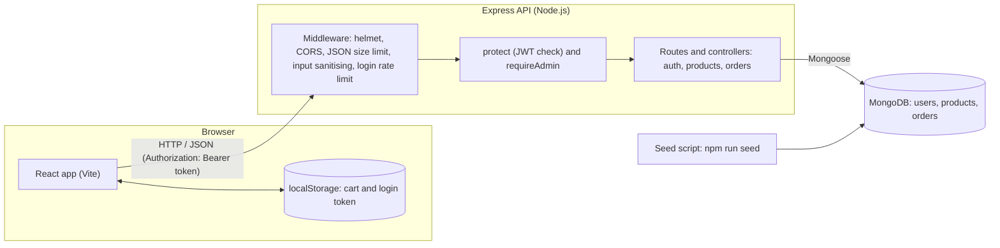

<div align="center">

# ShopSphere

**A full-stack e-commerce web application built with the MERN stack.**


Skill Nexis Full Stack Developer Internship (MERN) — **Week 4 Capstone**

</div>

> [!IMPORTANT]
> **Project status:** the source code, tests for the core logic, and documentation are complete.
> The app has **not** been run against a real MongoDB database, **not** opened in a browser and **not** deployed yet.
> Follow the steps below to do those parts. See [Known Limitations](#known-limitations).

## Table of Contents

- [Overview](#overview)
- [Features](#features)
- [Technology Stack](#technology-stack)
- [Architecture](#architecture)
- [Project Structure](#project-structure)
- [Getting Started](#getting-started)
- [Environment Configuration](#environment-configuration)
- [Available Scripts](#available-scripts)
- [API Documentation](#api-documentation)
- [Authentication and Security](#authentication-and-security)
- [Testing](#testing)
- [Uploading to GitHub from an Android Phone](#uploading-to-github-from-an-android-phone)
- [Deployment](#deployment)
- [Known Limitations](#known-limitations)
- [Capstone Context](#capstone-context)

## Overview

ShopSphere lets people browse products, create an account, fill a shopping cart and place an order.
Administrators can add, edit and delete products.

The application consists of a React frontend, an Express REST API and a MongoDB database.
Checkout is **simulated**: an order is saved, but no real payment is processed.

## Features

### Customers

- Home page, product list with **search, category filter, price/name sorting and pagination**
- Product details (name, description, price, image, stock)
- Register, log in, log out (token-based login)
- Shopping cart: add, remove, plus/minus quantity, subtotals and total, empty-cart message, stock limits (the cart is saved in the browser)
- Checkout and order placement, **order history** and order details
- Responsive layout (phone and desktop), loading, error and empty states

### Administrators

- Admin dashboard: add, edit and delete products (price, description, image URL, stock)

### Security highlights

- Passwords are hashed with scrypt (never stored as plain text)
- Login tokens (JWT) are checked on the server; the user's role is read from the database on every request
- Admin routes are protected **on the server**, not only hidden in React
- Prices and totals are always calculated on the server from database prices
- Stock is reserved with a safe database condition so items cannot be oversold
- Input validation on the server, MongoDB-operator stripping, request size limit, `helmet` headers, rate limit on login/register, CORS limited to your website address

Details are listed under [Authentication and Security](#authentication-and-security).

## Technology Stack

| Layer | Technologies |
|---|---|
| Frontend | React 18, React Router 6, Vite |
| Backend | Node.js, Express 4 |
| Database | MongoDB with Mongoose 8 (local or MongoDB Atlas) |
| Testing | Node's built-in test runner (`node --test`) |

## Architecture



**How the cart works:** the cart lives in the browser (`localStorage`) and is not stored on the server.
When you check out, only product ids and quantities are sent; the server loads real prices, checks stock, calculates the total and saves the order.

## Project Structure

```text
shopsphere-ecommerce/
├── README.md
├── .gitignore
├── backend/
│   ├── package.json
│   ├── .env.example
│   ├── src/
│   │   ├── server.js            starts the server
│   │   ├── app.js               Express setup, CORS, routes
│   │   ├── config/              env checks, database connection
│   │   ├── models/              User, Product, Order
│   │   ├── controllers/         auth, products, orders logic
│   │   ├── routes/              URL -> controller mapping
│   │   ├── middleware/          login check, admin check, errors
│   │   ├── utils/               validation, pricing, passwords, tokens, list-query parsing
│   │   └── seed/seed.js         creates admin + sample products
│   └── tests/                   backend tests
└── frontend/
    ├── package.json
    ├── .env.example
    ├── vercel.json
    ├── vite.config.js
    ├── index.html               (favicon is built in, so no public/ folder is needed)
    ├── src/
    │   ├── api/client.js        all backend calls
    │   ├── context/             login state, cart state
    │   ├── components/          navbar, shared UI, protected route
    │   ├── pages/               Home, Products, Details, Cart, Checkout, Orders, Admin, Login/Register
    │   └── utils/               cart maths, formatting
    └── tests/                   cart tests
```

## Getting Started

Run the project on a computer by following these steps.

### Prerequisites

- Node.js 18 or newer
- A MongoDB database: either MongoDB installed locally, or a free **MongoDB Atlas** cluster (see [Connect MongoDB Atlas](#connect-mongodb-atlas))
- Git and a GitHub account

### 1. Start the backend

```bash
cd backend
npm install
cp .env.example .env
```

Open `backend/.env` and set `MONGODB_URI` and a long random `JWT_SECRET`. Then:

```bash
npm run seed     # creates the admin account (from .env) and 12 SAMPLE products
npm run dev      # API on http://localhost:5000
```

Check it: open `http://localhost:5000/api/health` — you should see `{"status":"ok"}`.

### 2. Start the frontend

Use a second terminal:

```bash
cd frontend
npm install
cp .env.example .env
npm run dev      # website on http://localhost:5173
```

### 3. Log in as admin

Use the `SEED_ADMIN_EMAIL` and `SEED_ADMIN_PASSWORD` values you put in `backend/.env`
(the example file uses `admin@example.com` / `ChangeMe123` — **change these** before any real use).
Normal sign-ups through the website always become ordinary users, never admins.

### Connect MongoDB Atlas

1. Create a free account at mongodb.com/atlas and create a free cluster.
2. **Database Access** → add a database user (username + password).
3. **Network Access** → add IP address `0.0.0.0/0` (needed so Render can connect).
4. **Connect → Drivers** → copy the connection string.
5. Put it in `MONGODB_URI`, replace `<password>` with your password and add the database name `shopsphere` before the `?`.
6. Run `npm run seed` once (locally with that URI) to create the admin and sample products.

## Environment Configuration

Copy each `.env.example` file to `.env` and fill in your own values. Never commit a real `.env` file.

### Backend — `backend/.env`

| Variable | Meaning |
|---|---|
| `PORT` | Port number (Render sets this itself) |
| `MONGODB_URI` | MongoDB connection string |
| `JWT_SECRET` | Long random secret (32+ characters in production) |
| `JWT_EXPIRES_IN` | Login lifetime, e.g. `7d` |
| `CLIENT_URL` | Your website address(es) allowed by CORS, comma separated, no trailing `/` |
| `SEED_ADMIN_NAME` / `SEED_ADMIN_EMAIL` / `SEED_ADMIN_PASSWORD` | Used only by `npm run seed` |

### Frontend — `frontend/.env`

| Variable | Meaning |
|---|---|
| `VITE_API_URL` | `/api` locally; on Vercel use `https://YOUR-BACKEND.onrender.com/api` |
| `VITE_CURRENCY` | Currency code for prices, e.g. `USD`, `INR` |

## Available Scripts

| Location | Command | Purpose |
|---|---|---|
| `backend` | `npm start` | Start the API (`node src/server.js`) |
| `backend` | `npm run dev` | Start the API with automatic restart (`node --watch`) |
| `backend` | `npm run seed` | Create the admin account and sample products |
| `backend` | `npm test` | Run backend tests |
| `frontend` | `npm run dev` | Start the development website |
| `frontend` | `npm run build` | Build the production website |
| `frontend` | `npm run preview` | Preview the production build |
| `frontend` | `npm test` | Run frontend tests |

## API Documentation

All endpoints below are implemented.

| Method | Path | Access | Description |
|---|---|---|---|
| `GET` | `/api/health` | Anyone | Server check |
| `POST` | `/api/auth/register` | Anyone | Create account, returns token |
| `POST` | `/api/auth/login` | Anyone | Log in, returns token |
| `GET` | `/api/auth/me` | Logged in | Current user |
| `GET` | `/api/products` | Anyone | List. Query: `search`, `category`, `sort` (`newest`, `price_asc`, `price_desc`, `name`), `page`, `limit` |
| `GET` | `/api/products/categories` | Anyone | Category names |
| `GET` | `/api/products/:id` | Anyone | One product |
| `POST` | `/api/products` | **Admin** | Add product |
| `PUT` | `/api/products/:id` | **Admin** | Edit product |
| `DELETE` | `/api/products/:id` | **Admin** | Delete product |
| `POST` | `/api/orders` | Logged in | Place order. Body: `items: [{productId, quantity}]`, `shippingAddress` |
| `GET` | `/api/orders/mine` | Logged in | Your own orders |
| `GET` | `/api/orders/:id` | Owner or admin | One order |

Protected routes need the header `Authorization: Bearer <token>`.
Logging out simply deletes the token in the browser.

## Authentication and Security

- Passwords are hashed with scrypt (never stored as plain text).
- Login tokens (JWT) are checked on the server; the user's role is read from the database on every request.
- Admin routes are protected **on the server**, not only hidden in React.
- Prices and totals are always calculated on the server from database prices.
- Stock is reserved with a safe database condition so items cannot be oversold.
- Input validation on the server, MongoDB-operator stripping, request size limit, `helmet` headers, rate limit on login/register, CORS limited to your website address.

## Testing

```bash
cd backend && npm test      # 27 tests
cd frontend && npm test     # 6 tests
```

These test: price/total calculation, stock checks, input validation, password hashing, admin permission check,
error responses, MongoDB-operator stripping and cart maths.
They do **not** test the live API, the database or the React screens (see [Known Limitations](#known-limitations)).

### Verification status

| Check | Result |
|---|---|
| Backend tests (`node --test`) | Executed: 27 passed, 0 failed |
| Frontend tests (`node --test`) | Executed: 6 passed, 0 failed |
| Syntax and import-path checks of all source files | Executed (static checks): passed |
| Live API, real MongoDB, browser workflow, React screens | **Not run** |
| Deployment (Render, Vercel) | **Not done** |
| `npm install` | **Not run** when the package was created |

## Uploading to GitHub from an Android Phone

1. Extract the ZIP on your phone (Files app → long press → Extract).
2. In the GitHub website (open in Chrome, "Desktop site" is handy) create a **new repository**, e.g. `shopsphere-ecommerce`.
3. Tap **Add file → Upload files**, select the contents of the extracted folder (keep the `backend` and `frontend` folders), and **Commit changes**.
4. Check that no `.env` file was uploaded (only `.env.example` files should be there).

## Deployment

Deploy in this order: database → backend → frontend.

### Backend on Render

1. render.com → **New → Web Service** → connect your GitHub repo.
2. **Root Directory:** `backend` · **Build Command:** `npm install` · **Start Command:** `npm start`
3. Environment variables: `NODE_ENV=production`, `MONGODB_URI`, `JWT_SECRET` (32+ random characters), `CLIENT_URL` (you will fill in the Vercel address after the step below), `JWT_EXPIRES_IN=7d`.
4. Deploy, then open `https://YOUR-BACKEND.onrender.com/api/health`. (Free Render services sleep when idle, so the first request can take about a minute.)

### Frontend on Vercel

1. vercel.com → **Add New → Project** → import the same repo.
2. **Root Directory:** `frontend` (framework: Vite). Build `npm run build`, output `dist`.
3. Environment variable: `VITE_API_URL` = `https://YOUR-BACKEND.onrender.com/api`
4. Deploy. Copy the Vercel address (like `https://shopsphere.vercel.app`).
5. Go back to Render → Environment → set `CLIENT_URL` to that address (no trailing `/`) → save (it redeploys).

`frontend/vercel.json` makes page refreshes on routes like `/cart` work.

### Troubleshooting

| Problem | Likely cause and fix |
|---|---|
| "Cannot reach the server" in the app | `VITE_API_URL` is wrong, or the Render service is still waking up. |
| CORS error in browser console | `CLIENT_URL` on Render does not exactly match your Vercel address. |
| Backend crashes on start | Read the Render logs; it prints which variable is missing. |
| MongoDB connection fails | Check Atlas user/password, the `0.0.0.0/0` network rule, and the database name in the URI. |
| Admin login fails | Run `npm run seed` against the same database the backend uses. |

## Known Limitations

- **Not run against a real MongoDB, browser or deployment** by the author of this package; the Express routes, Mongoose models and React screens are verified only by syntax/import checks (see [Testing](#testing)). Expect to fix small issues on first run.
- Dependencies were not installed when this package was created, so there is no `package-lock.json`; `npm install` creates it (commit it afterwards).
- Payment is **simulated** — orders are saved, no money moves.
- The cart is stored per browser, not per account. Prices shown in the cart can be older than the database price; the server total at checkout is the real one.
- No password reset, email verification or admin order management screen.
- Stock reservation uses per-product atomic updates with manual rollback, not a database transaction.
- Login token is kept in `localStorage` (simple, but exposed if the site had an XSS bug).
- No automated tests for the HTTP API or React screens.

## Capstone Context

ShopSphere is the Week 4 capstone project (Capstone Project and Deployment) of the Skill Nexis Full Stack Developer Internship (MERN).
The selected capstone option is the E-Commerce Web Application: product listing, user authentication, cart and order management, plus an admin dashboard for product control.
